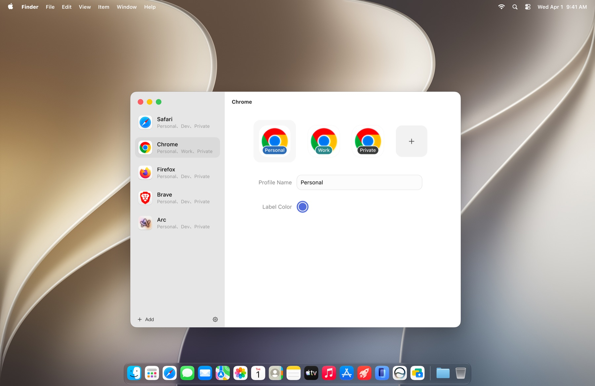

# DockSpark

[English](README.md) · [简体中文](README.zh-CN.md) · [繁體中文](README.zh-TW.md) · [日本語](README.ja.md) · [한국어](README.ko.md) · [Deutsch](README.de.md) · [Français](README.fr.md) · [Español](README.es.md)

DockSpark vous permet de changer de profil de navigateur directement depuis le Dock de macOS. Survolez l’icône d’un navigateur compatible, puis choisissez le profil souhaité sans ouvrir le menu des profils du navigateur.

[Télécharger la dernière version](https://github.com/DockSpark/DockSpark/releases/latest)
· [Site web](https://dockspark.app)
· [Historique des modifications (en anglais)](CHANGELOG.md)
· [Signaler un problème](https://github.com/DockSpark/DockSpark/issues)

## Fonctionnalités

- Changer de profil depuis un panneau rattaché à l’icône du navigateur dans le Dock
- Gérer les profils de navigateur dans une application macOS native
- Personnaliser les noms et les couleurs pour identifier rapidement les profils
- Choisir les profils nommés qui apparaissent dans le menu au survol du Dock
- Utiliser DockSpark Free ou passer à Pro pour un nombre illimité de navigateurs et de profils
- Afficher ou masquer les icônes de la barre des menus et du Dock
- Rechercher les mises à jour dans l’application
- Ouvrir la documentation ou envoyer des commentaires structurés depuis le menu Aide
- Utiliser l’application en anglais, chinois simplifié, chinois traditionnel, japonais, coréen, allemand, français ou espagnol
- Adapter la taille des panneaux à celle des icônes du Dock, y compris lors de l’agrandissement
- Désactiver l’analyse anonyme de l’utilisation dans les réglages généraux

## Configuration requise

- macOS 14.0 ou version ultérieure
- Mac avec puce Apple ou processeur Intel
- Un navigateur compatible conservé dans le Dock

### Navigateurs compatibles

| Navigateur | Changement de profil depuis le Dock |
| --- | --- |
| Safari | Pris en charge |
| Firefox | Pris en charge |
| Google Chrome | Pris en charge |
| Chromium | Pris en charge |
| Microsoft Edge | Pris en charge |
| Brave Browser | Pris en charge |
| Vivaldi | Pris en charge |
| Opera | Pris en charge |
| Opera GX | Pris en charge |
| Arc | Pris en charge |

Safari, Google Chrome et Firefox sont activés par défaut lorsqu’ils sont installés. L’offre Free permet d’activer un navigateur et d’utiliser trois profils nommés par navigateur. Les entrées de navigation privée et de mode incognito ne comptent pas dans cette limite. Pro supprime ces limites. Vous pouvez ajouter d’autres navigateurs installés depuis la liste des applications.

## Installation

### Homebrew

```sh
brew trust --cask dockspark/tap/dockspark && \
  brew install --cask dockspark/tap/dockspark
```

### Téléchargement manuel

1. Ouvrez la [dernière publication](https://github.com/DockSpark/DockSpark/releases/latest).
2. Téléchargez `DockSpark-0.5.0.dmg`. Ne téléchargez pas les archives de code source générées automatiquement par GitHub.
3. Ouvrez l’image disque et glissez `DockSpark.app` dans le dossier Applications.
4. Lancez DockSpark et accordez les autorisations macOS demandées.

Le fichier `DockSpark-0.5.0.zip` est également disponible pour une installation manuelle.

DockSpark est signé avec un certificat Developer ID et notarié par Apple.

## Autorisations

DockSpark demande uniquement les autorisations système nécessaires au changement de profil :

- **Accessibilité** détecte les interactions du pointeur avec les icônes des navigateurs compatibles dans le Dock.
- **Automatisation** permet à DockSpark de demander au navigateur sélectionné de changer de profil.
- **Accès complet au disque** est facultatif. DockSpark l’utilise uniquement pour découvrir les métadonnées des profils Chromium et Firefox.

Vous pouvez consulter ou révoquer ces autorisations à tout moment dans **Réglages Système > Confidentialité et sécurité**.

## Utilisation

1. Ajoutez un navigateur compatible au Dock.
2. Configurez le navigateur et ses profils dans DockSpark.
3. Survolez l’icône du navigateur dans le Dock.
4. Sélectionnez un profil dans le panneau.

## Skill pour les assistants IA

Le [skill DockSpark](skills/dockspark/SKILL.md) aide les assistants IA à expliquer les fonctions de DockSpark et ses cas d’usage, à vous guider lors de l’installation et de l’utilisation quotidienne, à trouver la documentation officielle et à résoudre les problèmes courants. La version **0.5.0** du skill suit celle de l’application ; les guides fournis ont été vérifiés pour DockSpark 0.5.0. L’assistant répond dans votre langue.

Installez-le avec la [Skills CLI](https://github.com/vercel-labs/skills) (Node.js est requis ; consultez sa documentation pour les prérequis actuels) :

```sh
npx skills add DockSpark/DockSpark --skill dockspark
```

Choisissez votre assistant IA lorsque vous y êtes invité. Par défaut, l’installation s’applique au projet en cours ; ajoutez `-g` pour une installation globale. La commande GitHub nécessite que le skill ait été publié dans ce dépôt. Depuis une copie locale du dépôt, utilisez :

```sh
npx skills add . --skill dockspark
```

Pour une [installation manuelle dans Codex](https://developers.openai.com/codex/skills/), copiez tout le dossier `skills/dockspark`, y compris `references/` et `agents/`, dans `~/.agents/skills/dockspark` ou dans `.agents/skills/dockspark` au sein de votre projet. D’autres assistants peuvent utiliser des dossiers de skills différents. Rechargez les skills de votre assistant ou démarrez une nouvelle session si le skill n’apparaît pas.

Exemples de demandes :

- `Utilise $dockspark pour m’expliquer ce que DockSpark peut m’aider à faire.`
- `Utilise $dockspark pour m’aider à configurer les profils Chrome.`
- `Utilise $dockspark pour trouver pourquoi rien ne se passe lorsque je survole une icône du Dock.`

Vous pouvez poser les mêmes questions en anglais ou dans une autre langue. Le skill fournit des conseils ; installez DockSpark séparément pour utiliser l’application. À chaque nouvelle version de l’application, vérifiez les guides et les liens officiels du skill, puis mettez à jour sa version et la version de référence vérifiée ensemble.

## Capture d’écran



> Cette capture présente l’interface de DockSpark. La version 0.5.0 permet de changer de profil depuis le Dock pour Safari, Firefox, Chrome et les autres navigateurs basés sur Chromium listés ci-dessus.

## Mises à jour

DockSpark utilise Sparkle pour les mises à jour intégrées à l’application. Vous pouvez aussi télécharger les versions manuellement depuis la [page des publications](https://github.com/DockSpark/DockSpark/releases).

## Intégrité des fichiers publiés

Les sommes de contrôle SHA-256 sont les suivantes :

```text
DockSpark-0.5.0.dmg  90c0f9369d67eb33e6939b1cac008ec70277f7c176c0f2a1aa0e50fb08e85eff
DockSpark-0.5.0.zip  1d7eb10b9ce7736f2a1e5f1fd790eebb399675fadb95702a6032f329f65db129
```

Vérifiez-les après le téléchargement :

```sh
shasum -a 256 DockSpark-0.5.0.dmg DockSpark-0.5.0.zip
```

## Commentaires

Utilisez [GitHub Issues](https://github.com/DockSpark/DockSpark/issues) pour signaler des bugs ou suggérer des améliorations. Pour un rapport de bug, indiquez votre version de macOS, celle du navigateur et les étapes permettant de reproduire le problème.

Ce dépôt contient les éléments publics de distribution de DockSpark. Le code source de l’application n’est pas inclus.
